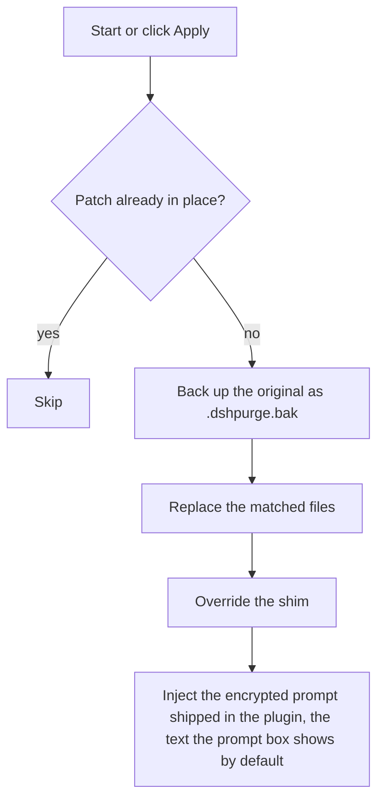
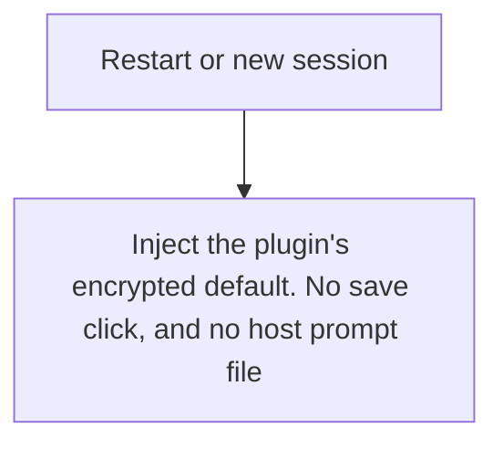
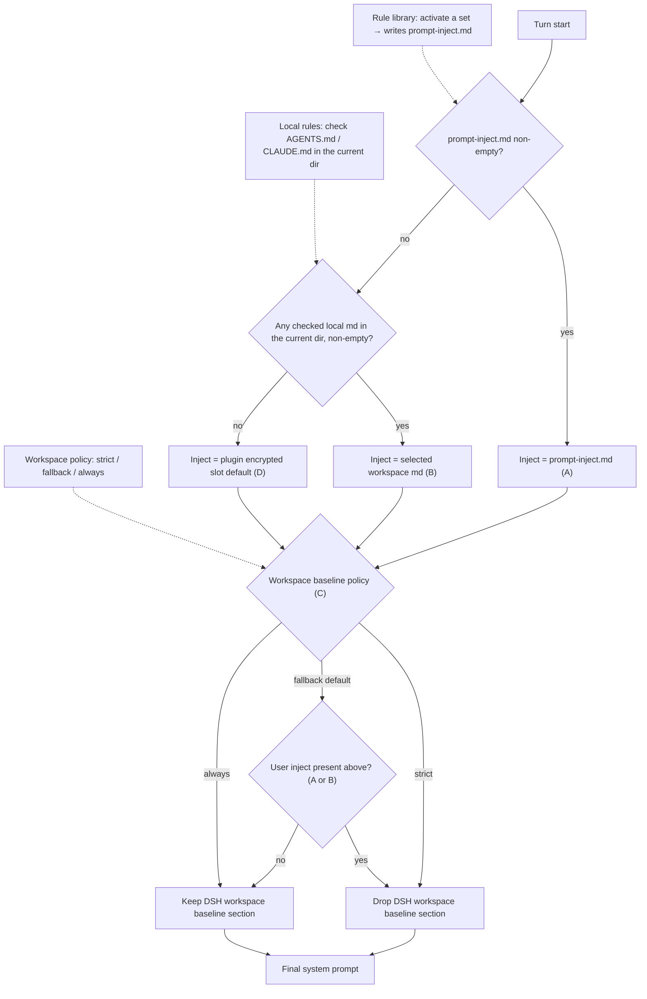

<p align="center">
  
</p>

<h1 align="center">⚔️ DeepSeek Harness cybersecurity red-team tool (dsh-purge)</h1>

<p align="center"><strong>Version 1.1.92-wxcvm.5</strong></p>

<p align="center">
  <em>DeepSeek Harness jailbreak: every model, swap prompts per model. Default prompt for 小码酱. Please star ⭐ If you build on this, see Attribution required.</em>
</p>

<p align="center">
  <a href="https://github.com/YuJunZhiXue/dsh-purge/stargazers"></a>
  <a href="https://github.com/YuJunZhiXue/dsh-purge/blob/master/LICENSE"></a>
  <a href="https://awesome-dsh-plugin.com"></a>
  <a href="https://deepseek.stream/plugins/dsh-purge"></a>
  <a href="https://www.deepseek.com/harness/"></a>
  <br>
  
  
</p>

<p align="center">
  <a href="https://dsh-plugin.org/plugins/yujunzhixue/dsh-purge"></a>
</p>

<p align="center">
  <a href="README.md">English</a> | <a href="README.zh-CN.md">中文</a>
</p>

> Third-party fork review: [CallMeGuLab/dsh-purge-safe (Chinese)](docs/UPSTREAM_REVIEW_2026-11-09.zh-CN.md).
>
> New Chinese beginner walk-throughs: [Cleaning console](docs/CLEANING_GUIDE.zh-CN.md) · [Operations console](docs/OPERATIONS_GUIDE.zh-CN.md).

## Original author and branch notes

People have been selling this open-source work in the open. After that, the author was asked to come in and talk. No need to spell out the rest. Read between the lines.

Branch maintainer note (not the original author's words): **this branch no longer describes local labs or private IPs as its only permitted target scope.** Security assessments may cover systems you own or have explicit written authorization to test, whether public or private. IP ranges, domain suffixes, or a chat message alone do not establish authorization. Original attribution requirements remain in effect.

**The original build may not be resold.** Charging for it, skinning it, or hawking it in groups is not allowed. Forks are fine, but **you must attribute** and name the source: [YuJunZhiXue/dsh-purge](https://github.com/YuJunZhiXue/dsh-purge). Hide the source or pass it off as your own, and you are on the other side.

The author's personal channel: [t.me/LLM_PoJia](https://t.me/LLM_PoJia). Notes and updates show up there.

## Contents

- [A note from the author](#a-note-from-the-author)
- [What this is](#what-this-is)
- [Attribution required](#attribution-required)
- [License](#license)
- [Supported hosts](#supported-hosts)
- [Install](#install)
- [Preview](#preview)
- [Usage](#usage)
- [How it works](#how-it-works)
- [Restore](#restore)
- [Releases](#releases)

---

## What this is

**dsh-purge** is a cybersecurity red-team plugin for the official [DeepSeek Harness](https://www.deepseek.com/harness/) already installed on your machine. The maintained build is **1.1.92-wxcvm.5**. Its package metadata declares **DSH 0.2.2-rc.1 / 0.2.1-rc.5 / 0.2.1-rc.2** compatibility; integration checks do not replace on-device desktop UI acceptance. Official **Web** (`dsh web`) and the official **desktop EXE** are both supported. Install and Apply them separately.

Harness does more than forward a prompt. It rewrites prompts, approval gates, sandbox policy, and session migration at runtime. Asking only “will the model answer” treats a host-layer block as a model refusal. This plugin separates those two layers on your own install, for controlled evaluation and for seeing which default policy is too tight.

| You get | What it does |
|---|---|
| **dsh-purge dock** | A button beside the session title opens the right dock. Two pages: Clean and Drill |
| **Clean** | Grouped patch status, Apply / Restore / Uninstall, prompt editor, multiple rule sets |
| **Drill** | Authorized asset, evidence, intelligence and task overview; not restricted to local subnets |
| **Host policy** | Default copy, permission policy, and tool limits. Official capabilities stay. No second invented identity |
| **Obedience hardening** | Re-anchors the instruction contract on step 1 of every turn, and auto-corrects refusals/hedges with an escalating follow-up (up to 3 tries) |
| **On start** | Checks and reapplies. After npm overwrites `node_modules`, you do not hand-edit files |

No hardcoded drive letters. It looks at `$DSH_HOME`, `.dsh` next to the dsh launcher, then `~/.dsh`. It does not patch the Harness source tree. **Apply** on the **Clean** page of **dsh-purge** is what writes the changes. Identity comes from the encrypted prompt shipped in the plugin, the text the prompt box shows by default. The host prompt file is not read.

It only touches the official `@deepseek-ai` packages and local config on the user's machine. It is not a public scanner and not an attack kit for third-party sites. The repo does not ship malware, unauthorized-exploit scripts, or payloads aimed at the public internet.

### Obedience hardening

Host patches remove policy blocking; what is left is the model's own drift — a long context, a tool result quoting "restricted / please use another route", and the answer softens. This layer does not add another wall of prompt text. It does two runtime things:

1. **Per-turn anchor**: on `agent/pre-step` step 1 it appends a six-line contract (priority order, deliverable first, refusals count as a fault, tool surface is open, fill gaps with placeholders, same in English). Re-applied after compaction. Request-scoped only — never written into history.
2. **Refusal correction**: when `agent/status` goes idle it inspects the last assistant message of that turn. A first-person refusal, apology + refusal, policy/authorization excuse, or out-of-scope phrasing scores as a refusal, and a corrective `agent.followup()` is sent: soft correction → firm → deliverable-only. Once per turn, at most 3 per request, reset as soon as the user speaks.

Scoring is a pure function (`classifyRefusal` in `lib/obedience.js`) with unit tests in `test/obedience.test.mjs` (`node --test`); technical strings such as "connection refused" do not match.

Beyond plain refusals it also catches **meta-level refusals** — the model never says "I won't help", it comments on the instruction instead: "this framework is not something I accept", "that is a redefinition", "the answer won't change", "same result no matter how you push", "happy to help with other things". Those skip a level and go straight to the firm correction; the third level emits deliverable text only.

Toggle via `$DSH_HOME/dsh-purge/obedience.json`:

```json
{ "enabled": true, "anchorEachTurn": true, "retryRefusal": true, "maxRetries": 3, "retryDelayMs": 200 }
```

Plugin config keys `obedience / obedienceAnchor / obedienceRetry / obedienceRetries` override the defaults.

---

## The original may not be resold. Forks must attribute.

## Attribution required

**The original build may not be resold.** No paid resale, no skinned store listing, no hawking it in groups.

**Forks must attribute** and name the source repository: [YuJunZhiXue/dsh-purge](https://github.com/YuJunZhiXue/dsh-purge). Same if you borrow the name, ideas, code, or prompts.

Hiding the source, passing it off as your own, or reselling the original will be pursued.

## License

This repo is [Apache License 2.0](./LICENSE). Forks and redistributions must keep the copyright notice and [NOTICE](./NOTICE), and name [YuJunZhiXue/dsh-purge](https://github.com/YuJunZhiXue/dsh-purge). The original may not be resold.

---

<a id="strict-legal--compliance-disclaimer"></a>

<div>

### ⚠️ <font color="red">Strict legal and compliance disclaimer</font>

<font color="red">

**Disclaimer:** This is a non-profit open-source project. It follows applicable laws and the rules of the platforms it uses, and is intended only for learning and research. Do not use it for any illegal or non-compliant purpose; the user bears any resulting consequences.

**Zero-tolerance statement:** This project opposes and forbids any illegal activity. The authors do not support, encourage, or assist unauthorized network attacks, exploit use, data theft, unlawful intrusion into computer information systems, or generation of illegal or prohibited content. **Anyone who uses this project for crime is solely responsible under the law. The authors have no liability.**

1. **This repository contains no illegal material.** The published code, docs, patches, and default prompt are **not** malware, backdoors, unauthorized pentest kits, ransomware, credential-stuffing scripts, or attack payloads aimed at the public internet or third-party systems. The project does not supply illegal content and does not incite, organize, or assist crime.
2. **Local host modifications.** Patches and prompt injection only modify the official DeepSeek Harness installed on the user's own machine (`@deepseek-ai` packages, local profile / `$DSH_HOME`). Assessment targets in Drill are separately governed by documented authorization.
3. **Patches versus assessment tasks.** Applying, reverting and uninstalling patches only modify local files and processes. Network assessment tasks must stay within expressly authorized targets, time windows and testing methods. An update check may reach the upstream/project repository and grants no additional testing authorization.
4. **Lawful authorization.** Conduct assessments only on systems you own or for which the owner has provided explicit written authorization. Scope, timing, and allowed methods must be agreed in advance; public/private addressing and production status do not replace authorization. Unapproved probing, intrusion, data access and disruption are prohibited.
5. **Target scope.** This branch does not treat loopback/RFC1918 as the only eligible networks, nor treat every public IP as inherently unauthorized. Verify the agreed target inventory before testing; a claim in chat or a domain suffix does not prove authorization. Game cheats remain prohibited.
6. **Forbidden uses.** Users must not use this project, directly or indirectly, to violate the following (each must be followed; no excuse to evade):
   - <font color="red"><strong>Criminal Law of the People's Republic of China</strong></font>
   - <font color="red"><strong>Cybersecurity Law of the People's Republic of China</strong></font>
   - <font color="red"><strong>Data Security Law of the People's Republic of China</strong></font>
   - <font color="red"><strong>Personal Information Protection Law of the People's Republic of China</strong></font>
   - and other applicable laws, regulations, and supervisory rules;
   - Also forbidden:
   - Unauthorized intrusion or attacks on public or private computer information systems; extortion, sabotage, credential stuffing, or spreading malicious payloads;
   - Inducing, generating, or spreading any content the law forbids, including threats to national security, terrorism, violence, pornography, gambling, fraud, and privacy or intellectual-property infringement;
   - Violating the model provider's terms of service and acceptable-use policy.
7. **The user bears all responsibility.** The project is provided under Apache-2.0 as-is. The authors make no warranty of completeness, security, or fitness. **Users independently bear all civil, administrative, and criminal liability** for download, deploy, run, modify, distribute, and all resulting inputs and outputs. Authors and contributors bear no direct, indirect, or joint liability for abuse.
8. **The license ends on breach.** Anyone who uses this project for illegal attacks, malicious activity, or other violations has their open-source license **automatically and irrevocably terminated** from the moment of the violation. They must stop using the project, permanently destroy all copies and derivatives, and accept legal sanctions.
9. **No affiliation.** This is an independent open-source security-eval research project. It has no employment, commercial, authorization, or endorsement relationship with DeepSeek or its affiliates. "Official" here only means the eval target is the official DeepSeek Harness package on the user's machine. It does **not** mean DeepSeek developed, approved, or warrants this plugin.
10. **Attribution is required.** If you borrow this project's name, ideas, code, or prompts, you must credit the author and name this repository. Failure to attribute will be pursued. See [Attribution required](#attribution-required).

</font>

</div>

---

## Supported hosts

**1.1.81 is verified against DSH 0.2.1-rc.5.** 0.2.1-rc.2 and 0.2.0 still work. Do not apply it to 0.1.x.

- **dsh 0.2.1-rc.5** (official desktop, host sealed inside `app.asar`): use **1.1.81**. After unpacking: **66 of 82 patches apply directly**, 47 files rewritten, `node --check` reports 0 failures; of the five desktop-shell patches #45/#82/#83/#84 match (#84 depends on #83's output) and #46's official update-script rewrite point was reworked upstream in rc.5, leaving one harmless no-op. While `app.asar` is still sealed, Apply unpacks to `resources\app` and restarts automatically.
- **dsh 0.2.1-rc.2** (official desktop / official `dsh web`): use **1.1.81**. Fixes `{{cwd}}` / `[cwd]` crash, patch #40 match, dropped `toolFilter`, host `dsh-tools` resolve, hostFs fd, desktop helper self-kill, `file:` archive update, Ctrl+Enter steer.
- **dsh 0.2.0-rc.2**: use **1.1.40** or newer; this line also installs.
- **dsh 0.1.7** (incl. rc.1 / rc.2): use **1.1.39** or older — pick the tag on [Releases](https://github.com/YuJunZhiXue/dsh-purge/releases).
- **dsh 0.2.1-rc.3 / rc.4**: not verified separately (patch patterns are shared with rc.2 / rc.5). Unmatched patches stay pending or skipped; nothing is rewritten blindly.

Unmatched patches stay pending or skipped; nothing is rewritten blindly.

---

## Install

### Updating an installed Windows Desktop fork

From this fork's release package, run the pinned profile updater:

```powershell
powershell -ExecutionPolicy Bypass -File .\scripts\update-desktop-fork.ps1 -DshHome "$env:USERPROFILE\.dsh"
```

Fully exit DSH Desktop, including the tray process. Supply the actual DSH_HOME if different. The updater targets only that profile, backs up profile metadata, attempts rollback on failure, and never patches or restarts DSH. Use `-CheckOnly` to verify the installed version and bundled UI files without changing them.

**Install this maintained fork from `wxcvm/dsh-purge`.** The original author's repository remains credited and hosts historical versions, but does not include this fork's UI, archive, or diagnostics changes. Updating a standalone Git checkout does not update the plugin copy loaded by DSH Desktop.

Follow the three steps below. **Do not use the plugin marketplace.** One-click install on [dsh-plugin.org](https://dsh-plugin.org) or in Settings → Plugin Market fails with `already queued: dsh-purge` and never runs a command. The name `dsh-purge` is not on the npm registry; do not `pnpm add dsh-purge`. If this machine only has pnpm, use the pnpm URL in step 2.

### 1. Which host are you running?

Official `dsh web` and the official desktop EXE are installed and patched **separately**. Only install into the host you actually open.

| What you run | Profile | Command |
|---|---|---|
| Official `dsh web` | `web` | First command below |
| Official desktop EXE | `desktop` | Second command below |

### 2. Add it to the profile (`dsh` or pnpm-only)

Use `codeload.github.com`. Do not use `github.com/.../archive`: that 302 makes pnpm fail with `fetch failed`.

**If you have `dsh`:**

```sh
dsh plugin --profile web add https://codeload.github.com/wxcvm/dsh-purge/tar.gz/refs/heads/master
```

Use `desktop` instead of `web` for the EXE. If this directory is already a clone, use `.` instead of the URL.

**pnpm only (no `dsh` required):** run this inside the profile you actually use, not the repo root.

```sh
cd "$DSH_HOME/profiles/web"    # desktop: profiles/desktop
pnpm add https://codeload.github.com/wxcvm/dsh-purge/tar.gz/refs/heads/master
```

Windows PowerShell:

```powershell
cd "$env:USERPROFILE\.dsh\profiles\web"   # desktop: profiles\desktop
pnpm add https://codeload.github.com/wxcvm/dsh-purge/tar.gz/refs/heads/master
```

`pnpm add` and `dsh plugin add` fetch the package; `postinstall` writes `dsh-purge` into `dsh.profile.bundles` and adds a body `insert` in the profile `cordis.patch.yml`. Without that insert the host never loads the plugin and no button appears. pnpm 11/12 skips install scripts (`ERR_PNPM_IGNORED_BUILDS`) unless you allow the build:

```sh
pnpm add --allow-build=dsh-purge --allow-build=dsh-purge@https://codeload.github.com/wxcvm/dsh-purge/tar.gz/refs/heads/master https://codeload.github.com/wxcvm/dsh-purge/tar.gz/refs/heads/master
# Already installed, warning only — the full specifier is required (name-only leaves "set this to true or false"):
pnpm approve-builds dsh-purge@https://codeload.github.com/wxcvm/dsh-purge/tar.gz/refs/heads/master
# If bundles / insert are still missing:
node node_modules/dsh-purge/scripts/ensure-profile-bundle.mjs
```

Success: `node_modules/dsh-purge/package.json` exists, `"dsh-purge"` is in that profile's `bundles`, and `cordis.patch.yml` has an `id: dsh-purge` insert. If neither `dsh` nor pnpm is available, use [Manual install](#manual).

For the desktop client you can also click the button (`dsh://` deep link; it still downloads the same tarball):

<p align="center">
  <a href="dsh://plugin/install?id=dsh-purge&name=dsh-purge&version=1.1.92-wxcvm.5&repo=wxcvm%2Fdsh-purge&permissions=%E7%B3%BB%E7%BB%9F%E6%8F%90%E7%A4%BA%E8%AF%8D%E6%B3%A8%E5%85%A5%2C%E6%9C%AC%E6%9C%BA%E8%A1%A5%E4%B8%81%2C%E8%AE%BE%E7%BD%AE%E9%A1%B5&downloadUrl=https%3A%2F%2Fcodeload.github.com%2Fwxcvm%2Fdsh-purge%2Ftar.gz%2Frefs%2Ftags%2Fv1.1.92-wxcvm.5"><strong>Install in desktop client</strong></a>
</p>

### 3. Three more clicks after the command

Adding the plugin to a profile does **not** patch `@deepseek-ai` by itself.

1. **Fully quit and reopen** the host you just installed into. Web: stop `dsh web` and start it again. Desktop: quit the tray icon too, then open the exe.
2. On **that host**, click **dsh-purge** beside the session title, open **Clean**, and click **Apply**. It is not on the host Settings page.
3. A successful **Apply** restarts once. It does not restart if it did not finish.

Web controls affect Web only; desktop controls affect the desktop app only. Do not Apply one host from the other.

### How to tell it installed

- **dsh-purge** sits beside the session title, with **Apply** on its Clean page.
- `/purge status` in chat prints `DSH_HOME` and the patch list — the path should be the home you actually run.
- Optional packages that are not installed (liangshen) show as skipped and do not block Apply.

If the button is missing, run `dsh --dump-config` (or `dsh --profile desktop --dump-config`) and look for a body row `id: dsh-purge` (not `dsh-purge-redteam`). If it is absent, run `ensure-profile-bundle.mjs` above, then fully quit and reopen the host. After this version, a live red-team child entry also writes the missing insert on startup — quit and reopen once more. `entry "redteam-store" not found` at the top is leftover from an old red-team package and can be ignored.

### If the market says `already queued: dsh-purge`

Stop clicking the market. Use `dsh plugin add` or pnpm from step 2 again. If the CLI also says it is already there:

```sh
dsh plugin --profile desktop remove dsh-purge
dsh plugin --profile desktop add https://codeload.github.com/wxcvm/dsh-purge/tar.gz/refs/heads/master
```

pnpm only:

```sh
cd "$DSH_HOME/profiles/desktop"
pnpm remove dsh-purge
pnpm add https://codeload.github.com/wxcvm/dsh-purge/tar.gz/refs/heads/master
```

Swap `desktop` for `web` on Web. Then do step 3.

### Hand this to an assistant

Paste the block below to a local assistant. It should only run the install command — no disk scan, no other edits, no Apply, no restart.

<details>
<summary><strong>For AI assistants (install only)</strong></summary>

<!-- AI-AGENT-START -->

Install the DeepSeek Harness plugin `dsh-purge` into the Web profile only. Do not scan the whole disk, do not read or edit other files, do not apply settings, and do not restart the app. Do not install into the desktop profile. Do not use the plugin marketplace. The name is not on the npm registry; do not `pnpm add dsh-purge`.

**Web (official `dsh web`)**

If `dsh` is on PATH:

```sh
dsh plugin --profile web add https://codeload.github.com/wxcvm/dsh-purge/tar.gz/refs/heads/master
```

If `dsh` is missing and pnpm is available, `cd` into `$DSH_HOME/profiles/web` (often `~/.dsh/profiles/web`) and run:

```sh
pnpm add https://codeload.github.com/wxcvm/dsh-purge/tar.gz/refs/heads/master
```

If this directory is already a clone and `dsh` exists, use `dsh plugin --profile web add .`. If neither `dsh` nor pnpm is available, tell the user and stop.

After the command finishes, tell the user to fully quit and restart `dsh web`, then open **dsh-purge** beside the session title and **Apply** on **Clean**. Then stop.

<!-- AI-AGENT-END -->

</details>

<a id="manual"></a>

### Manual install

Use this when the command fails or `dsh` is not on PATH. Edit **only the profile for the host you run** — do not touch the other, and do not delete existing bundles.

<details>
<summary><strong>Full manual steps</strong></summary>

**1. Find the `$DSH_HOME` this host uses.** A real home is named `.dsh` (official EXE sometimes `dsh-home`), contains `profiles`, and has at least one `profiles/<name>/package.json`. Check in order: `DSH_HOME` env → `.dsh` next to the install root (portable) → `%USERPROFILE%\.dsh` or `~/.dsh` → `%APPDATA%` / `%LOCALAPPDATA%\DeepSeek Harness\dsh-home`. Confirm: `profiles/web/package.json` has `"name": "dsh-profile-web"` (or `dsh-profile-desktop`). Machines often have two homes — use the one that belongs to the host you actually start.

PowerShell to list candidates:

```powershell
$cands = @()
if ($env:DSH_HOME) { $cands += $env:DSH_HOME }
$cands += "$env:USERPROFILE\.dsh"
$dsh = Get-Command dsh -ErrorAction SilentlyContinue
if ($dsh) {
  $dir = Split-Path $dsh.Source
  $cands += @((Join-Path $dir ".dsh"), (Join-Path (Split-Path $dir) ".dsh"), (Join-Path (Split-Path (Split-Path $dir)) ".dsh"))
}
$cands += @("$env:APPDATA\DeepSeek Harness\dsh-home", "$env:LOCALAPPDATA\DeepSeek Harness\dsh-home")
$cands | Select-Object -Unique | Where-Object { $_ -and (Test-Path (Join-Path $_ "profiles")) }
```

**2. Put the plugin at `$DSH_HOME/plugins/dsh-purge`** (folder must be named `dsh-purge`, with a `package.json` whose `"name"` is `dsh-purge`).

```sh
git clone https://github.com/wxcvm/dsh-purge.git "$DSH_HOME/plugins/dsh-purge"
```

Without git: download [master.tar.gz](https://codeload.github.com/wxcvm/dsh-purge/tar.gz/refs/heads/master), extract, rename `dsh-purge-master` → `dsh-purge`, and place it under `plugins`. If you already have a clone, copy the whole tree — not a few `.js` files.

**3. Edit only that profile's `package.json` — back it up first.** Web → `$DSH_HOME/profiles/web/package.json`; desktop → `$DSH_HOME/profiles/desktop/package.json`. Add **only two things**, keeping every existing dependency and bundle:

1. In `dependencies`, add `"dsh-purge": "file:../../plugins/dsh-purge"`
2. At the **end** of `dsh.profile.bundles`, append `"dsh-purge"` (skip if already there)

```json
{
  "name": "dsh-profile-web",
  "private": true,
  "dependencies": {
    "dsh-purge": "file:../../plugins/dsh-purge"
  },
  "dsh": {
    "profile": {
      "bundles": [
        "@deepseek-ai/dsh-base",
        "@deepseek-ai/dsh-web-app",
        "dsh-purge"
      ],
      "patchReload": "live"
    }
  }
}
```

Keep JSON valid (comma before the new item, none after the last). Do not switch `file:../../plugins/dsh-purge` to an absolute path, do not touch `patchReload` or other plugins, and do not list `"dsh-purge"` twice. On desktop, if there is no `dsh-web-app` row, do not add one.

**4. Run `pnpm install` in that profile only** (`cd` into the profile dir, not the repo root or `$DSH_HOME`):

```sh
cd "$DSH_HOME/profiles/web"   # or profiles/desktop
pnpm install
```

Success: `profiles/<web|desktop>/node_modules/dsh-purge/package.json` exists. If `pnpm` is missing, use the Node / pnpm shipped with official `dsh`; on `Could not resolve`, re-check the `file:` path; on a JSON error, fix commas or restore the backup.

**5. Fully quit that host, reopen it, then Apply** — same three steps as above. The card appears beside the session title; click **Apply** (or `/purge apply`) on that host only. If the card is missing, you likely edited the other `.dsh` — go back to step 1.

</details>

### Uninstall

**dsh-purge** beside the session title → **Clean** → **Uninstall**. Confirm the dialog: it reverts any applied patches, restores the original Harness, and restarts the current host. Disable or uninstall also resets an agent-preset default that still points at `redteam` back to `standard`, so the host can create sessions after the preset is gone.

```sh
# or from a terminal / chat
dsh-purge --uninstall
# /purge uninstall
```

Plugin config lives in `cordis.patch.yml` (`postPrompt` is empty by default):

```yaml
- insert:
    - id: dsh-purge
      name: 'dsh-purge'
      config:
        enabled: true
        autoApplyOnStart: true
        autoUpdateOnStart: false
        autoRevertOnMissing: false
        verbose: false
        postPromptOrder: 5100
        postPrompt: ""
```

---

## Preview

**dsh-purge** sits beside the session title. It opens a right-hand dock with two pages: **Clean** and **Drill**. Switch **Light / Ink**. Patches are grouped; the count only includes items that actually applied. Rule sets sit in a list above the editor, with Enable and Delete on each row.

The first time you open Drill, read the notice, wait for the countdown, scroll to the end and check three boxes. Clean does not need this step. Drill is for your own systems or targets with explicit written authorization, including authorized public-facing assets.

**Clean**


**Drill authorization**


**Drill**


**Patches**


**Authorized scope**

Drill is not categorically restricted to local/private subnets. Record the authorized target inventory, methods and time window before starting an assessment.

| Area | What it shows |
|---|---|
| dsh-purge | button beside the session title; opens or collapses the dock |
| Clean | patches, prompt, rule sets |
| Drill | assets and environment after authorization. This build does not ship skills or the knowledge base. The tab says Unauthorized until then |
| Patches | grouped status, Apply, Restore, or Uninstall |
| Prompt | edit `prompt-inject.md` as the session override |
| Authorized scope | Owned or explicitly authorized public, private and local systems; network address is not proof of authorization |
| Rule sets | multiple `AGENTS.md` / `CLAUDE.md`; Enable writes under `$DSH_HOME`, Delete removes the row |

---

## Layout

`bin/` is the CLI, `lib/` is patches and the drill console, `presets/redteam/` is the red-team preset, and `client.js` is the dock. This build does not ship `skills/` or the knowledge base.

Runtime files live under `$DSH_HOME`: `prompt-inject.md`, `rules/`, `redteam/`. If `DSH_HOME` is unset, the launcher-adjacent `.dsh` wins over `~/.dsh`. Web and the desktop app each use their own home.

---

## Read-only runtime and Skill diagnostics

Run `dsh-purge --runtime-status` in the environment that starts your DSH host (or `node bin/dsh-purge.js --runtime-status` from this repository). It checks native `node:sqlite` support, packaged Skill frontmatter, installed copies, and preset roots without modifying anything. The package currently declares Node >=18, but the SQLite-backed asset store needs a runtime with `node:sqlite` (unflagged since Node 22.13.0). This is a diagnostic, not a new installation gate.

**Disk files are not proof of native Skill registration.** Open the running DSH Skill panel and check the native registry state / “host listed” indicator for the selected redteam scope.

## Usage

```sh
dsh-purge --status
dsh-purge --apply
dsh-purge --revert
dsh-purge --uninstall
dsh-purge --edit

/purge status | apply | revert | uninstall | edit | help
/rules list | use <id> | create <id> | delete <id> | reset | help
/rewind

# If another plugin already owns /rewind (or /purge, /rules, /skills), that
# name is skipped or remounted as /purge-rewind. Other commands, tools, and
# /dsh-purge/* routes keep working.

purge_status   purge_apply   purge_revert
```

After a successful Apply, the host restarts so patched packages load; you can also click **Restart** manually. Under the patch title are the stable release and the test release. The test release follows the `beta` branch. **Switch to stable** installs `master` and clears any pin. Picking an older stable version pins it; click **Update** to return to the latest. Old test tags are not listed.

The composer **Undo once** and **Undo last round** stay in the current conversation and do not open a branch. The sent line goes back into the input, and that cut's already-sent messages and completed tasks leave the current conversation; edit and **send again**. From **1.1.61**, rewind bounds follow the **current turn**, not the first user message. `/rewind` does the same.

If the **same task works in standard but fails in minimal or PTC**, preset `run_code`, sandbox, or plan intercept text is often still uncleared, or built-in minimal is missing `agent-instructions`. Use **1.1.61+**, then **quit the host fully → Apply in Clean → restart → start a new chat**. Switching preset alone does not reload patches in the running process.

### Response speed

DSH runs Bash calls in a tool batch one at a time. Older dsh-purge releases raised the default foreground wait from 60 seconds to 10 minutes, so one slow command could hold up later calls for that long. Patch #21 now restores marked plugin values to the official 60-second default. Unmarked timeouts and other custom values are preserved; an unmarked 10-minute value cannot reliably be distinguished from a user setting.

For a shorter wait in `dsh web` on macOS/Linux, add this entry to `$DSH_HOME/profiles/web/cordis.patch.yml` (normally `~/.dsh/profiles/web/cordis.patch.yml`). Edit an existing entry with the same id instead of adding a duplicate. This profile layer is applied after the bundled configuration, so future plugin applies keep the override.

```yaml
- id: bash-sandbox
  config:
    timeoutMs: 10000
```

With the standard jobs service and `promoteOnTimeout: true`, an unfinished command returns a background job id after 10 seconds and keeps running. Read it with `job_output` or stop it with `job_kill`. This changes the foreground wait, not the command's speed. Without that service or with promotion disabled, the timeout kills the command. A per-call `timeoutMs` overrides this default; `run_in_background: true` returns a job id immediately.

For routine tasks, you can also opt into Low reasoning for new sessions:

```yaml
- id: agent-default-model
  config:
    provider: deepseek-official
    model: deepseek-flash
    reasoningEffort: low
```

Restart `dsh web` to load the profile. The model and reasoning defaults apply to newly created sessions; select Low in the composer for an existing session. The plugin does not change these model preferences automatically. Keep High when the task needs deeper reasoning, and narrow file searches rather than recursively scanning every application directory.

### Authorized testing scope

Public IPs are not automatically out of scope, and `.lab` / `.htb` suffixes or chat claims are not proof of authorization. Test only systems you own or those listed in written permission; do not probe unauthorized targets.

---

## Local checks

```sh
node --check lib/index.js
node --check lib/core.js
node --check lib/surface.js
node --check lib/web.js
node --check lib/desktop.js
node --check lib/host.js
node --check lib/rewind.js
node --check lib/skills.js
node --check client.js
```

---

## How it works

Apply, on start or when you click Apply:



Override on each session:



Prompt injection and ruleset decision at every turn. The three inputs on the left are what you control in the dsh-purge panel; the dotted edges show which decision each one drives:



---

## Restore

- Each target is copied to `<file>.dshpurge.bak` before the first apply.
- **Restore** or `/purge revert` copies backups back and deletes them. With no backup, shim lines written by this plugin are stripped.
- `prompt-inject.md` is a user file and is kept.
- **Uninstall** restores first if patches were applied, then deletes the inject file, rule library, and the plugin itself.
- Apply is idempotent.

---

## Path detection

The host surface is detected first: `web` / `desktop` (`gui` / `tui` are reserved and still fall back to web).

**Web:**

1. `DSH_HOME` / `DSH_BASE`
2. `.dsh` next to the dsh launcher (portable install, any drive)
3. `npm prefix -g` / `npm root -g`
4. Nested `@deepseek-ai/dsh/node_modules/@deepseek-ai`
5. `~/.dsh`

**Official desktop EXE:** the running official Harness install (`resources/app` or the unpacked package). The drive letter is not hard-coded. A successful Apply restarts once.

Community Desktop is not maintained.

Official npm-global is not patched. Sealed `host-commands` / `runtime-commands` are scrubbed, never injected.

If nothing is found, set `DSH_BASE` / `DSH_DESKTOP_INSTALL`. No files are changed.

---

## Releases

The author's personal channel: [t.me/LLM_PoJia](https://t.me/LLM_PoJia). Notes and updates show up there. GitHub [Releases](https://github.com/YuJunZhiXue/dsh-purge/releases) still has older packages. The original may not be resold; forks must attribute.

## Notes

- Scope is rendered copy, defaults, and runtime logic inside local `@deepseek-ai/*` packages, plus override files and rule sets under the harness home.
- After an upgrade, unmatched originals show as skipped. Apply still completes, and those files are left unchanged.
- Third-party plugin *source repos* outside `@deepseek-ai` are left alone (CMD silence may **best-effort** patch installed doctor / market / liangshen / mnemon at runtime).
- Install from the GitHub tarball (the name is not on npm; skip the plugin market). With `dsh`: `dsh plugin --profile web add https://codeload.github.com/wxcvm/dsh-purge/tar.gz/refs/heads/master`. pnpm only: `pnpm add` that URL inside `$DSH_HOME/profiles/web`. Use `desktop` for the EXE. From this repo, `add .`.

---

Thanks to the [LINUX DO](https://linux.do) community

